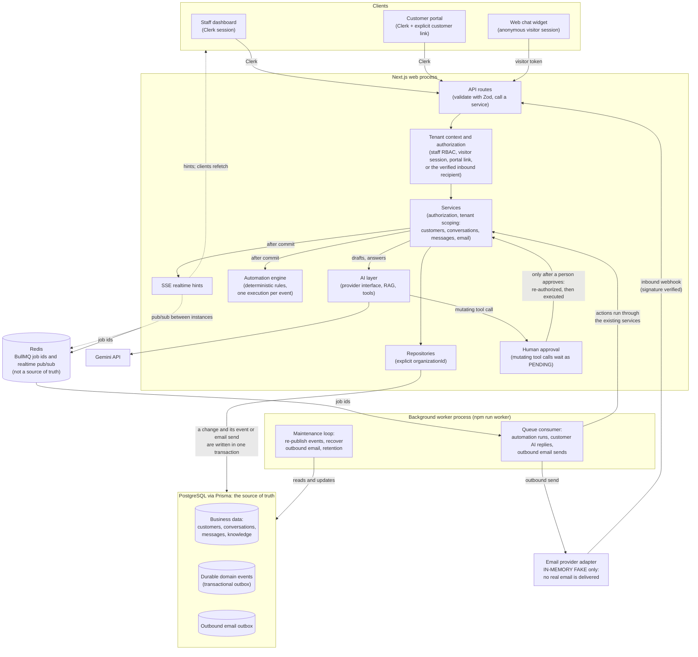

# Architecture

A **modular monolith**: one codebase and one PostgreSQL database, run as two separate processes: the Next.js web
application and the BullMQ background worker (`npm run worker`).

A high-level overview (solid arrows are calls or writes, dotted arrows are best-effort notifications):



PostgreSQL is the source of truth: Redis carries job ids and realtime hints only, so a lost job is recreated from the database. The AI layer never
executes a state-changing action on its own: a mutating tool call waits for a person's approval and then runs through the same services and authorization.
The email provider is an in-memory fake: no real email is delivered.

```text
src/
├── app/            Routes and API handlers. Thin: parse/validate input, call a service, shape the response.
├── db/             Prisma client access.
├── generated/      Prisma client output (gitignored, produced by `prisma generate`).
├── features/       Feature-specific schemas, helpers and client components (organizations so far).
├── lib/            Small, single-purpose modules (env, logger). No grab-bag utils file.
└── server/
    ├── auth/       Clerk adapter (identity.ts), tenant context, permissions.
    ├── ai/         Provider interface, Gemini adapter, embeddings, config, the support agent.
    ├── http/       API handler wrapper (error mapping, JSON parsing), param helpers.
    ├── repositories/  Prisma queries; org-scoped functions take an explicit organizationId.
    └── services/   Application logic and authorization rules.
                    `jobs/` and `integrations/` are added when the first feature needs them.
```

## Rules

- No business logic in React components or route handlers; they call services.
- Services own authorization and tenant scoping. Data access never trusts client-supplied org ids.
- All external input is validated with Zod. Environment is validated once in `src/lib/env.ts`.
- Logging goes through `src/lib/logger.ts` (Pino, structured, secrets redacted).
- The AI provider is only reachable through a dedicated service abstraction (to be added).

## Current surface

- Auth, organizations, memberships and RBAC: see [authentication](authentication.md) and
  [authorization](authorization.md). Endpoint reference: [api](api.md).
- Customers: [customer management](customer-management.md). Conversations and the inbox:
  [conversations](conversations.md). Each feature follows the same route -> service -> repository
  layering with an explicit organization on every query.
- Knowledge base, RAG and the AI agent: [knowledge-base](knowledge-base.md), [rag](rag.md),
  [ai-agent](ai-agent.md). All AI access goes through `src/server/ai` (a provider interface with one
  Gemini implementation); services and routes never import the SDK. A deterministic conversation
  policy ([ai-conversation-policy](ai-conversation-policy.md)) runs before retrieval and answers
  small talk, off-topic and injection attempts without RAG or a model call.
- Client server-state (TanStack Query, optimistic updates, outbox): [server-state](server-state.md).
  Pages load initial data on the server; client views refetch and mutate through the same REST API.
- AI tools, deterministic authorization and human approval: [ai-tools](ai-tools.md). The model may
  request an action; only application code authorizes and executes it. Tools call the existing
  services (`src/server/ai/tools`), mutations wait in `ai_action_approvals` for a human.
- Automations: [automations](automations.md). Services emit typed domain events after commit; a deterministic
  engine matches enabled automations, records one execution per (automation, event) (unique key =
  idempotency) and a BullMQ worker (`npm run worker`) runs the actions through the existing services with the
  automation creator's current permissions. PostgreSQL is the source of truth; Redis carries BullMQ job ids (ids only, never business data; the same queue and worker also run customer AI replies and
  outbound email wake-ups) and the realtime pub/sub.
- `GET /api/health` — returns 200 `{status:"ok"}` or 503 `{status:"degraded"}` depending on DB reachability.
- Web chat widget and realtime: [widget](widget.md), [realtime](realtime.md). Visitors are anonymous
  sessions (not users or members) that reach only a dedicated public API (`/api/widget/*`); their chats
  are normal conversations (`WEB_CHAT`) written through the same services via an `Actor` abstraction.
  Realtime is SSE hints published after commit (Redis pub/sub between instances); clients refetch from the
  authorized API. See ADR [011](decisions/011-visitor-sessions-and-sse-realtime.md).
- Customer-facing AI replies (web chat): [customer-ai](customer-ai.md), ADR
  [012](decisions/012-customer-facing-ai-read-only.md). A read-only path (no tools, no customer record)
  on the existing queue; the internal draft workflow is unchanged.
- Customer portal: [portal](portal.md), ADR [014](decisions/014-customer-portal-identity-linking.md). A third
  authorization context (an authenticated customer, via an explicit invitation-created link) next to staff and
  anonymous visitors; conversations reuse the existing domain through a `portal` actor.
- Email channel (Phase 9; only an in-memory fake provider exists, so no real email is sent): [email](email.md), ADR
  [015](decisions/015-email-channel-and-provider-adapter.md). `EMAIL` conversations, per-organization
  addresses and a narrow provider adapter. Inbound processing exists (9.2, `POST /api/email/inbound`), and staff replies go out through the outbound outbox described next (9.3 to 9.7). Domain events are durable (transactional outbox, ADR [016](decisions/016-durable-domain-events.md)) for every channel's messages and conversations; outbound email is a durable outbox with at-least-once workers and no blind resend ([email-outbound](email-outbound.md), ADR [017](decisions/017-outbound-email-outbox.md)); housekeeping runs in the worker and its health is `GET /api/health/background` ([email-operations](email-operations.md)). The provider-neutral adapter contract: [email-adapter-contract](email-adapter-contract.md).
